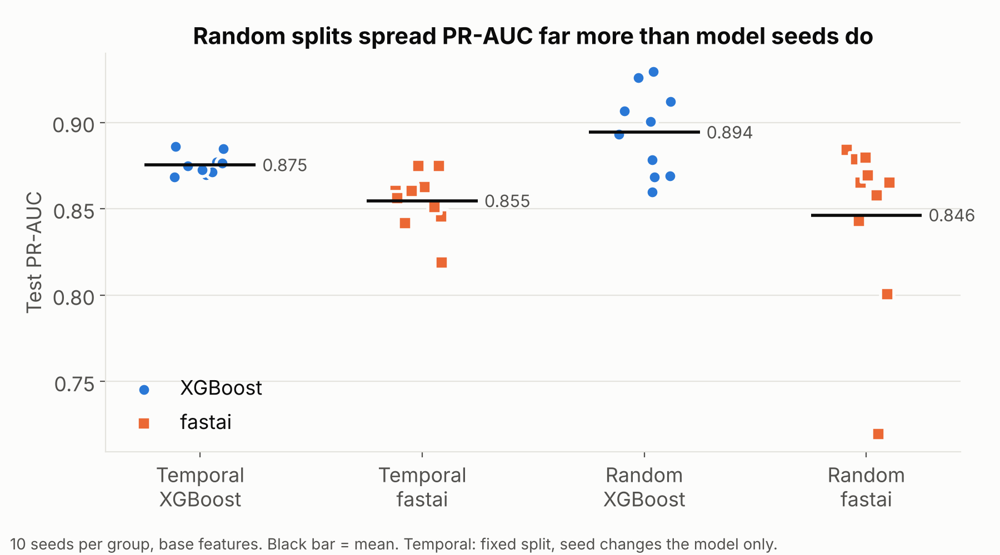
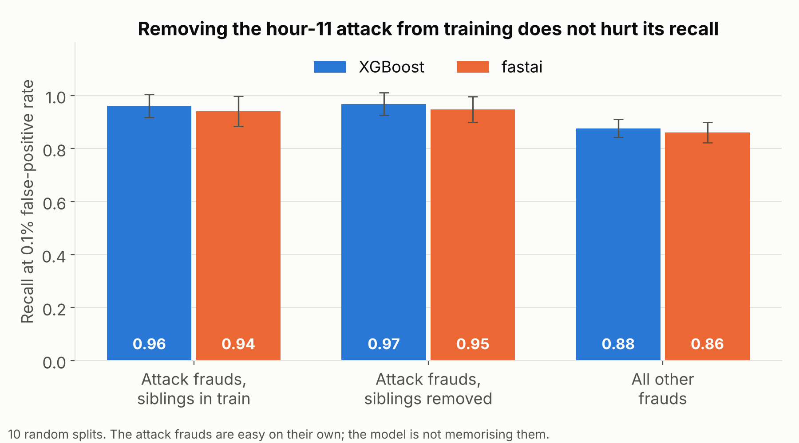
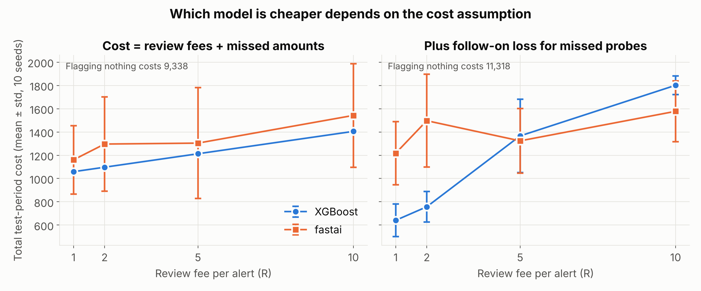
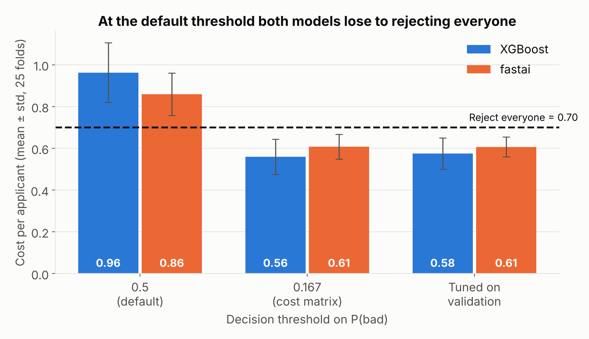

# Person A: XGBoost, fastai, cost and split experiments

This folder has the XGBoost and fastai models for both datasets, plus four experiments: cost-based thresholds, a card-testing cost model, velocity features, and temporal vs random splits. Shared loading, splitting and metric code is in `common/` so the other frameworks can reuse the exact same splits.

## How to run

```bash
pip install -r requirements.txt
bash person_a/run_all.sh
```

This takes about 10 minutes on a 2-core CPU. Every number below comes from the CSVs in `results/person_a/`, and the figures are in `results/person_a/figures/`.

| Script | What it does | Output |
|---|---|---|
| `run_fraud.py` | 2 models x 2 feature sets x 2 splits x 10 seeds on the credit card data | `fraud_runs.csv`, `fraud_ci.csv`, `fraud_predictions.npz` |
| `analysis_cost.py` | Picks cost-minimising thresholds on validation, scores them on test | `cost_runs.csv`, `cost_summary.csv` |
| `analysis_attack.py` | Checks whether a random split lets the model memorise the hour-11 attack | `attack_control.csv` |
| `run_german.py` | 5 x 5 repeated stratified CV on German Credit, three threshold policies | `german_runs.csv` |
| `make_figures.py` | Draws the four figures | `figures/*.png` |

## Setup decisions

Credit card data. 381 exact duplicate rows are dropped first (none of them are fraud), leaving 99,618 rows and 223 frauds. The temporal split trains on the earliest 70% and tests on the latest 30%. The last 15% of the training period is the validation set, used for early stopping and for picking thresholds. That gives 162 frauds in train, 13 in validation and 48 in test. The random split uses the same sizes, stratified. Raw `Time` is not a feature, because under a temporal split the test hours never appear in training.

German Credit. We use `german.data` with readable category names. XGBoost gets one-hot columns fitted on the training fold only. fastai learns an embedding for each categorical column. Each training fold holds out 20% for early stopping and threshold tuning.

Both models output probabilities. The brief asks for RMSE, MAE and R²; we compute them on predicted probabilities against the 0/1 label, so RMSE is the square root of the Brier score.

## Results

### Credit card, temporal split (mean ± std over 10 seeds)

| Features | Model | PR-AUC | ROC-AUC | Recall at 0.1% FPR | RMSE | MAE | R² | Train time (s) |
|---|---|---|---|---|---|---|---|---|
| base | XGBoost | 0.875 ± 0.006 | 0.975 ± 0.004 | 0.871 ± 0.016 | 0.0191 | 0.0007 | 0.774 | 1.1 |
| base | fastai | 0.855 ± 0.017 | 0.962 ± 0.016 | 0.850 ± 0.022 | 0.0209 | 0.0033 | 0.728 | 2.5 |
| + velocity | XGBoost | 0.872 ± 0.013 | 0.974 ± 0.007 | 0.863 ± 0.022 | 0.0192 | 0.0008 | 0.769 | 1.3 |
| + velocity | fastai | 0.848 ± 0.012 | 0.952 ± 0.019 | 0.844 ± 0.018 | 0.0199 | 0.0032 | 0.751 | 2.5 |

XGBoost is ahead on average and its seed-to-seed spread is about a third of fastai's. The test set holds only 48 frauds, though, and the bootstrap 95% interval for PR-AUC (seed-averaged predictions) is roughly 0.79 to 0.96 for every model (`fraud_ci.csv`). The intervals overlap almost completely, so this test set can't confidently separate the two frameworks on PR-AUC.

### Velocity features did not help

The sample has no card ID, so the velocity features count system-wide activity from earlier rows only: transactions and micro transactions (amount at most 1.00) in the last 60 and 300 seconds, mean amount in those windows, share of micro transactions, and seconds since the previous transaction. They didn't improve either model (table above). Our reading is that bursts would show up per card, and without a card ID the system-wide counts mostly track the time of day.

### Temporal vs random split



With a random split, XGBoost's PR-AUC ranged from 0.860 to 0.930 across 10 splits, against 0.868 to 0.886 when only the model seed changes. For fastai the random-split range was 0.720 to 0.884. One random split could easily rank the frameworks differently from the next, and the split-to-split swing is bigger than the gap between the frameworks.

We expected the random split to inflate scores by letting the model see part of the hour-11 attack (43 frauds, median 25 s apart) during training. It didn't. Recall on the attack frauds stayed at 0.97 (XGBoost) and 0.95 (fastai) even after every hour-11 fraud was removed from training. Those frauds are simply easy to catch, and the model isn't memorising them.



### Cost-based evaluation on the credit card data

Cost model: each alert costs a review fee R, and each missed fraud costs its amount. The card-testing variant adds a follow-on loss for every missed probe (fraud of 1.00 or less), on the reasoning that a working stolen card is used again. The size of that follow-on loss is the mean training-period fraud above 1.00, which is 165.01. We don't know a real bank's review cost, so R is swept over 1, 2, 5 and 10. Thresholds are chosen on validation, never on test.



| Scenario | XGBoost cost | fastai cost | Welch t-test p |
|---|---|---|---|
| Amount only, R=1 to 10 | 1,059 to 1,405 | 1,161 to 1,542 | 0.16 to 0.56 |
| Card-testing, R=1 | 641 | 1,217 | < 0.001 |
| Card-testing, R=2 | 757 | 1,497 | < 0.001 |
| Card-testing, R=5 | 1,366 | 1,324 | 0.75 |
| Card-testing, R=10 | 1,801 | 1,578 | 0.026 |

Flagging nothing costs 9,338 (amount only) or 11,318 (card-testing) on the test period, so both models cut the cost by 83 to 94%. With amount-only cost, XGBoost is cheaper at every fee but never significantly, because fastai's results vary so much between seeds. Once card testing is counted, the winner depends on the review fee. With cheap reviews XGBoost costs about half as much. At R=10, fastai wins, because XGBoost's threshold barely moves and it keeps missing 20% of the probes.

The threshold matters more than the framework. At the default 0.5 threshold with R=5, fastai costs 2,796 against 1,304 with a validation-tuned threshold. With hindsight, the best threshold on the test set would cost 900 for XGBoost. Picking it from a validation period with only 13 frauds costs about a third more (1,213).

### German Credit (5 x 5 repeated CV, mean ± std)

| Model | ROC-AUC | PR-AUC | RMSE | MAE | R² | Cost at 0.5 | Cost at 0.167 | Cost, tuned |
|---|---|---|---|---|---|---|---|---|
| XGBoost | 0.780 ± 0.034 | 0.615 ± 0.052 | 0.411 | 0.322 | 0.193 | 0.96 ± 0.14 | 0.56 ± 0.08 | 0.58 ± 0.08 |
| fastai | 0.757 ± 0.028 | 0.596 ± 0.051 | 0.425 | 0.320 | 0.138 | 0.86 ± 0.10 | 0.61 ± 0.06 | 0.61 ± 0.05 |



Rejecting every applicant costs 0.70 per applicant under the 5:1 cost matrix. At the default 0.5 threshold, XGBoost does worse than that in all 25 folds and fastai in 24 of 25. Switching to the threshold the cost matrix implies, 1/(1+5) = 0.167, brings XGBoost down to 0.56 and fastai to 0.61. No retraining is needed, only a different cut-off.

Tuning the threshold on validation didn't beat 0.167 (0.58 vs 0.56 for XGBoost). With 160 validation rows the tuned threshold is noisy, while 0.167 comes straight from the cost matrix and works as long as the probabilities are reasonably calibrated. XGBoost has the lower Brier score (0.169 vs 0.181), which fits with it gaining more from the theoretical threshold.

At 0.167, XGBoost catches 86% of bad borrowers but rejects 61% of all applicants. That is what a 5:1 cost ratio implies, and a bank would probably weigh lost business more heavily than this matrix does.

## Limitations

The credit card sample covers about 18.7 hours of a single day, so the temporal split tests later hours of the same day, not a later day. The validation period has 13 frauds, which makes early stopping and threshold choice noisy. The cost model's review fee is an assumption we sweep, not a measured value, and the follow-on loss treats every caught probe as preventing exactly one average fraud.
